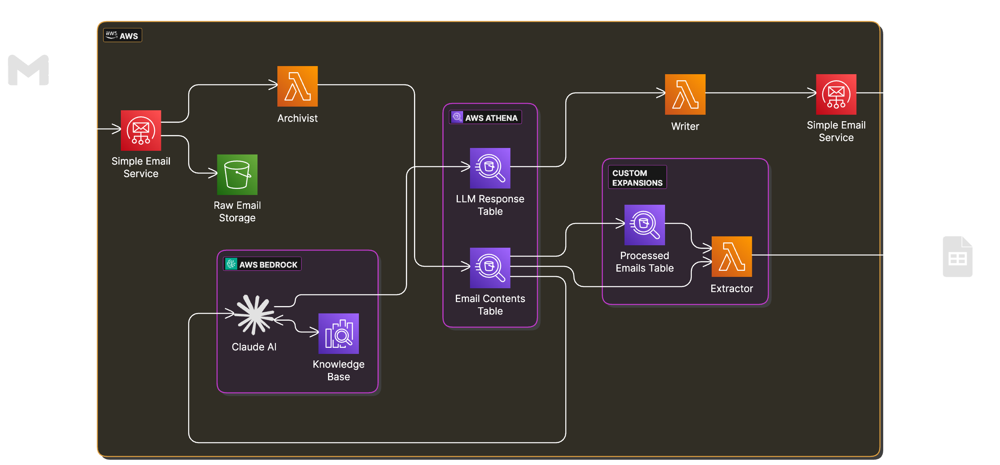

# EZComms Architecture Overview

The system is composed of several interconnected stacks that can be configured via the cdk.json file.

## Deployment Architecture

The system supports both development and production environments with different configurations managed through the AWS CDK context system (see the [Guides/Configuration](../guides/configuration.md) section).



**Storage Infrastructure**

- Central S3 bucket for data storage tied to each individual project/EZComms instances
- Athena database configuration (example sets up a base table to capture email content with user email and timestamp)
- Data tables for emails and responses (if LLM response functionality invoked)

**Incoming Email Processing (Archivist)**

- Simple Email Service configuration for receiving and storing emails
- S3 storage for email content
- Simple Notification topic for incoming email notifications
- Lambda layer/function for email processing utilities that can be configured as required depending on structured/unstructured email formats

**LLM-based Response Generation**

- Knowledge base integration
- Docker container for LLM processing and dependencies
- Lambda functions for AI processing/interaction
- Storage for response data in Athena

**Outgoing Email Functionality (Writer)**

- Docker container for email formatting and sending
- Lambda function for response delivery
- Email template and formatting
- **Two sending modes**:
  - **SES Mode**: Uses Amazon Simple Email Service with HTML/text templates defined in code
  - **Notify Mode**: Uses GOV.UK Notify service with templates managed in the Notify dashboard
- **Secrets Management** (Notify mode only): AWS Secrets Manager stores the GOV.UK Notify API key

## Data Flow

1. Emails are received through Amazon SES
2. Raw email content is stored in S3 
3. Raw mail storage triggers Eventbridge and email processing/Archivist function, storing email content in Athena and S3
4. LLM processing (if selected) analyses the email content against a pre-created knowledge base
5. LLM responses are generated and stored in Athena with a unique identifier for easy matching against incoming email 
6. Outgoing email system/Writer formats and sends responses to users via:
   - **Amazon SES**: Sends emails directly using AWS infrastructure
   - **GOV.UK Notify**: Sends emails via the Notify API using templates from the Notify dashboard

## Email Sending Architecture

### SES Mode
```
Lambda → SES → Recipient
```
- Lambda function generates HTML/text content from templates in code
- Sends directly via Amazon SES
- Requires verified domain in SES
- Templates managed in application code

### Notify Mode
```
Lambda → Secrets Manager (API Key) → GOV.UK Notify API → Recipient
```
- Lambda function retrieves API key from AWS Secrets Manager
- Calls GOV.UK Notify API with personalisation data
- Notify service handles template rendering and email delivery
- Templates managed in GOV.UK Notify dashboard
- Provides delivery status tracking via Notify dashboard